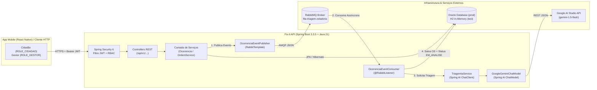

# Fix-It API — Plataforma Inteligente de Zeladoria Urbana Colaborativa (CitizenTech)

> **Global Solution FIAP 2026/2 — Java Advanced**  
> **Tema:** *CitizenTech — Tecnologia com o cidadão no centro da inovação*

---

## 1. Sobre o Projeto e Problema Resolvido

O **Fix-It** é uma plataforma **CitizenTech** de zeladoria urbana colaborativa que conecta cidadãos e o poder público municipal para identificar, priorizar e resolver problemas de infraestrutura nas cidades — como **crateras e buracos no asfalto, postes de iluminação pública apagados e bueiros obstruídos com risco de enchentes**.

Na gestão pública tradicional, chamados urbanos sofrem com triagem manual lenta, falta de priorização técnica e ausência de transparência para o morador. O **Fix-It** resolve esse gargalo integrando:
1. **Aplicativo Mobile (React Native)** para o cidadão reportar incidentes geolocalizados em segundos e acompanhar o protocolo de atendimento.
2. **Mensageria Assíncrona (RabbitMQ)** para recepção imediata dos chamados sem filas de espera.
3. **Inteligência Artificial Generativa (Spring AI + Google Gemini `gemini-1.5-flash`)** integrada ao fluxo de negócio para classificar automaticamente o nível de urgência (`BAIXA`, `MEDIA`, `ALTA`, `CRITICA`), recomendar a secretaria responsável, estimar o prazo de conclusão e redigir o **Parecer Técnico de Engenharia Urbana** na Ordem de Serviço.

### Conexão com os ODS da ONU (Agenda 2030)
- **ODS 9 (Indústria, Inovação e Infraestrutura):** Modernização da infraestrutura viária e urbana com triagem assistida por IA.
- **ODS 10 (Redução das Desigualdades):** Canal digital acessível para que moradores de bairros periféricos tenham a mesma prioridade técnica de atendimento baseada na criticidade real do risco.
- **ODS 11 (Cidades e Comunidades Sustentáveis):** Espaços públicos mais seguros, iluminados e transitáveis.
- **ODS 13 (Ação Contra a Mudança Global do Clima):** Prevenção ativa de alagamentos e enchentes urbanas por meio da priorização de desobstrução de bueiros e galerias pluviais.

---

## 2. Tecnologias Utilizadas e Requisitos Atendidos

| Requisito do Edital (Java Advanced) | Implementação no Fix-It API |
| :--- | :--- |
| **01. API REST do Domínio (20 pts)** | **Java 21 + Spring Boot 3.3.5 + Spring Data JPA**. Modelagem com 3 entidades relacionadas (`Usuario` 1:N `Ocorrencia` 1:1 `OrdemServico`), sequences compatíveis com **Oracle Database** e **H2**, e listagem paginada (`Pageable`). |
| **02. Validação e Tratamento de Erros (10 pts)** | **Bean Validation (`jakarta.validation`)** em todos os DTOs de entrada e tratamento global padronizado com `@RestControllerAdvice` (`GlobalExceptionHandler` + `ErrorResponseDTO`). |
| **03. Segurança com JWT e Papéis (20 pts)** | **Spring Security 6 Stateless + Auth0 JWT (`com.auth0:java-jwt`) + BCrypt**. Segregação de acesso RBAC entre Cidadão (`ROLE_CIDADAO`) e Gestor Público (`ROLE_GESTOR`). |
| **04. Funcionalidade com Spring AI (20 pts)** | **Spring AI (`ChatModel` + `ChatClient`) integrado ao Google Gemini (`gemini-1.5-flash` via Google AI Studio — 100% gratuito)**. Realiza a triagem técnica das ocorrências, classifica a urgência, define a secretaria municipal e gera o parecer técnico da Ordem de Serviço, contando com fallback determinístico resiliente caso `GEMINI_API_KEY` não esteja definida. |
| **05. Arquitetura Distribuída — Opção A (20 pts)** | **Opção escolhida: A) Mensageria Assíncrona com RabbitMQ (`spring-boot-starter-amqp`)**. Ao criar uma ocorrência (`POST /api/v1/ocorrencias`), o `OcorrenciaEventPublisher` publica um evento JSON na exchange `fixit.zeladoria.exchange` (`fila-triagem-zeladoria`), consumido assincronamente pelo `@RabbitListener` (`OcorrenciaEventConsumer`) que aciona o Google Gemini e gera a Ordem de Serviço em background. |
| **06. Documentação e Integração Mobile (10 pts)** | **Swagger / OpenAPI 3 (`springdoc-openapi`)** com suporte a Bearer Token JWT, **CORS global** liberado para consumo pelo App Mobile (React Native) e carga automática inicial via `DatabaseSeeder`. |

---

## 3. Arquitetura Macro da Solução



---

## 4. Como Rodar o Projeto Localmente

### Pré-requisitos
- **Java JDK 21** instalado (`java -version`).
- **Docker** (opcional — utilizado para subir o container do RabbitMQ; caso o Docker não esteja rodando, a API possui contingência automática síncrona e funciona normalmente).
- Não é necessário ter o Maven instalado globalmente: o projeto inclui o **Maven Wrapper** (`mvnw.cmd`).

### Passo 1: (Opcional) Subir o RabbitMQ via Docker Compose
Na raiz do projeto, execute:
```powershell
docker compose up -d
```
- **Painel Web do RabbitMQ:** [http://localhost:15672](http://localhost:15672) (Usuário: `guest` | Senha: `guest`)

### Passo 2: (Opcional) Configurar sua Chave Gratuita do Google AI Studio (`GEMINI_API_KEY`)
Você pode obter uma chave gratuita em [https://aistudio.google.com/app/apikey](https://aistudio.google.com/app/apikey) e defini-la no terminal antes de iniciar:
```powershell
$env:GEMINI_API_KEY="SUA_CHAVE_AQUI"
```
> **Observação importante para a avaliação:** Caso a variável `GEMINI_API_KEY` não seja informada, a aplicação sobe normalmente usando seu valor padrão seguro e executa o motor de contingência técnica local para que nenhum endpoint falhe durante a correção.

### Passo 3: Iniciar a API no Perfil `test` (Banco H2 em Memória — Recomendado para Testes Rápidos)
```powershell
.\mvnw.cmd spring-boot:run "-Dspring-boot.run.profiles=test"
```

### Alternativa: Iniciar no Perfil `prod` (Oracle Database FIAP)
```powershell
$env:ORACLE_DB_URL="jdbc:oracle:thin:@oracle.fiap.com.br:1521:ORCL"
$env:ORACLE_DB_USERNAME="RM_DO_ALUNO"
$env:ORACLE_DB_PASSWORD="SENHA_DO_BANCO"
.\mvnw.cmd spring-boot:run "-Dspring-boot.run.profiles=prod"
```

---

## 5. Acessos Rápidos e Usuários de Teste (`DatabaseSeeder`)

Ao iniciar a aplicação, a classe `DatabaseSeeder` popula automaticamente o banco (caso esteja vazio) com **2 usuários de teste** e **3 ocorrências urbanas em São Paulo** acompanhadas de suas respectivas **Ordens de Serviço e pareceres técnicos do Google Gemini**:

### Links Locais
- **Swagger UI (Documentação Interativa):** [http://localhost:8080/swagger-ui.html](http://localhost:8080/swagger-ui.html)
- **OpenAPI JSON Spec:** [http://localhost:8080/v3/api-docs](http://localhost:8080/v3/api-docs)
- **Console H2 Database (Perfil `test`):** [http://localhost:8080/h2-console](http://localhost:8080/h2-console)
  - *JDBC URL:* `jdbc:h2:mem:fixitdb` | *User:* `sa` | *Password:* *(em branco)*

### Credenciais de Teste Pré-Cadastradas

| Perfil | E-mail | Senha | Permissões Principais |
| :--- | :--- | :--- | :--- |
| **Cidadão (`ROLE_CIDADAO`)** | `cidadao@fixit.com` | `123456` | Abrir ocorrências (`POST /api/v1/ocorrencias`), listar ocorrências paginadas e consultar protocolo de Ordens de Serviço. |
| **Gestor Público (`ROLE_GESTOR`)** | `gestor@fixit.com` | `123456` | Todas as permissões do cidadão + alterar status (`PATCH`), excluir ocorrências (`DELETE`), acionar triagem IA (`POST /triagem-ia`) e despachar Ordens de Serviço (`POST /api/v1/ordens-servico`). |

---

## 6. Endpoints Principais da API e Exemplos de JSON

### 6.1. Autenticação (`/api/v1/auth`)
- **`POST /api/v1/auth/login`** *(Público)* — Autentica e retorna o token JWT:
  ```json
  {
    "email": "gestor@fixit.com",
    "senha": "123456"
  }
  ```
- **`POST /api/v1/auth/registrar`** *(Público)* — Cadastra um novo usuário:
  ```json
  {
    "nome": "Carlos Eduardo Silva",
    "email": "carlos@fixit.com",
    "senha": "Password@123",
    "perfil": "ROLE_CIDADAO"
  }
  ```

### 6.2. Ocorrências Urbanas (`/api/v1/ocorrencias`)
- **`POST /api/v1/ocorrencias`** *(`ROLE_CIDADAO`, `ROLE_GESTOR`)* — Cria ocorrência e dispara evento assíncrono no **RabbitMQ** para triagem com **Google Gemini**:
  ```json
  {
    "titulo": "Cratera na faixa da direita da Av. Paulista",
    "descricao": "Buraco profundo próximo ao cruzamento com a Rua Augusta causando risco para motociclistas.",
    "latitude": -23.558680,
    "longitude": -46.659620,
    "enderecoReferencia": "Av. Paulista, 2000 - Bela Vista, São Paulo - SP",
    "fotoUrl": "https://cdn.fixit.com.br/ocorrencias/cratera-paulista.jpg",
    "usuarioId": 1
  }
  ```
- **`GET /api/v1/ocorrencias?page=0&size=10&sort=dataAbertura,desc&status=EM_ANALISE`** *(`ROLE_CIDADAO`, `ROLE_GESTOR`)* — Listagem paginada com filtro opcional de `status`.
- **`GET /api/v1/ocorrencias/{id}`** *(`ROLE_CIDADAO`, `ROLE_GESTOR`)* — Detalhes da ocorrência por ID.
- **`GET /api/v1/ocorrencias/usuario/{usuarioId}?page=0&size=10`** *(`ROLE_CIDADAO`, `ROLE_GESTOR`)* — Ocorrências paginadas por cidadão autor.
- **`POST /api/v1/ocorrencias/{id}/triagem-ia`** *(Exclusivo `ROLE_GESTOR`)* — Executa triagem técnica sob demanda via **Spring AI + Google Gemini (`gemini-1.5-flash`)**.
- **`PATCH /api/v1/ocorrencias/{id}/status`** *(Exclusivo `ROLE_GESTOR`)* — Atualiza o status da ocorrência:
  ```json
  {
    "novoStatus": "CONCLUIDO"
  }
  ```
- **`DELETE /api/v1/ocorrencias/{id}`** *(Exclusivo `ROLE_GESTOR`)* — Exclui uma ocorrência que não esteja em execução.

### 6.3. Ordens de Serviço (`/api/v1/ordens-servico`)
- **`POST /api/v1/ordens-servico/despacho-ia/{ocorrenciaId}`** *(Exclusivo `ROLE_GESTOR`)* — Despacha automaticamente uma Ordem de Serviço preenchendo urgência, secretaria responsável, prazo e parecer técnico com o **Google Gemini (`gemini-1.5-flash`)**.
- **`POST /api/v1/ordens-servico`** *(Exclusivo `ROLE_GESTOR`)* — Emite/atualiza uma Ordem de Serviço enriquecida com parecer do Google Gemini:
  ```json
  {
    "ocorrenciaId": 1,
    "nivelUrgencia": "CRITICA",
    "equipeResponsavel": "Secretaria Municipal de Subprefeituras - Equipe Tapa-Buraco",
    "dataPrevistaConclusao": "2026-11-25"
  }
  ```
- **`GET /api/v1/ordens-servico/ocorrencia/{ocorrenciaId}`** *(`ROLE_CIDADAO`, `ROLE_GESTOR`)* — Consulta a Ordem de Serviço vinculada ao ID da ocorrência.
- **`GET /api/v1/ordens-servico/protocolo/{protocolo}`** *(`ROLE_CIDADAO`, `ROLE_GESTOR`)* — Consulta a Ordem de Serviço pelo protocolo UUID.

---

## 7. Coleções de Teste Incluídas no Repositório

Na raiz do projeto estão disponíveis dois arquivos prontos para testar todo o fluxo (Autenticação JWT, RBAC, CRUD Paginado, Triagem Spring AI com Google Gemini e Mensageria RabbitMQ):
1. **[`FixIt-Postman-Collection.json`](./FixIt-Postman-Collection.json)**: Basta abrir o Postman, pressionar `Ctrl + O` (Import) e selecionar o arquivo.
2. **[`testes-seguranca.http`](./testes-seguranca.http)**: Roteiro de requisições HTTP executável diretamente na IDE via extensão *REST Client*.

---

## 8. Declaração de Uso de IA Generativa (Conformidade FIAP Global Solution)

Em conformidade com as diretrizes de integridade acadêmica da Global Solution FIAP:
1. **No Produto (Funcionalidade de Negócio — Requisito 04):** A aplicação integra o modelo **Google Gemini (`gemini-1.5-flash`)** via **Google AI Studio** e **Spring AI (`ChatModel` / `ChatClient`)** no serviço `TriagemIaService` para realizar a classificação automatizada de risco e geração de pareceres técnicos de engenharia nas Ordens de Serviço de zeladoria urbana.
2. **No Processo de Desenvolvimento:** Ferramentas de assistência por IA Generativa (Google Gemini / Antigravity) foram utilizadas como apoio para estruturação de boilerplate, revisão de padrões arquiteturais do Spring Boot 3, geração de massa de dados de teste (`DatabaseSeeder`) e documentação técnica. Todo o código-fonte, regras de negócio, modelagem JPA e configurações de segurança foram revisados, testados e validados pela equipe.

